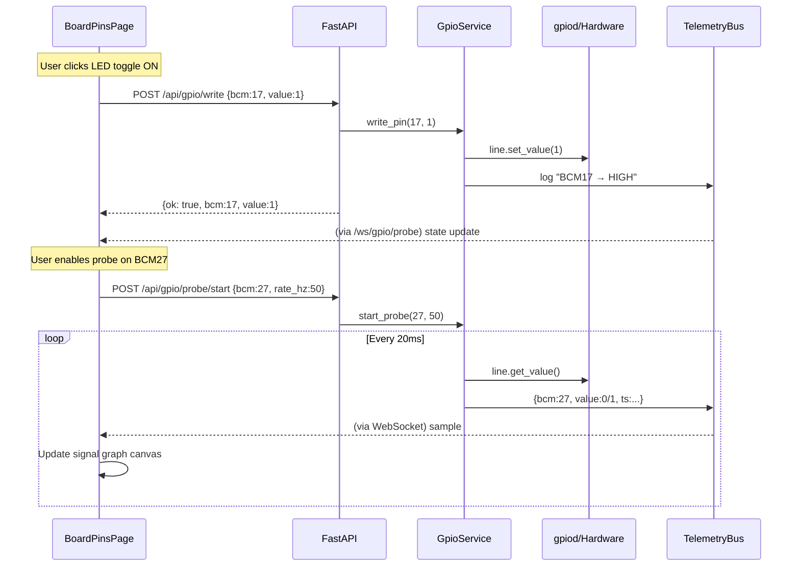

# Live GPIO Pin Control & Debugging for Board Pins Page

Replace the current static Board Pins page with an interactive GPIO debugger that can drive real hardware pins (RPi Zero 2W), read sensor values, plot signals in real time, and save pin assignments as duck config.

## Hardware — RPi Zero 2W Wiring (from diagram)

| Device | Type | BCM Pin(s) | Direction | Notes |
|--------|------|-----------|-----------|-------|
| Eye LED 1 | LED | **TBD** | OUT | Wire traces to header — please confirm BCM # |
| Eye LED 2 | LED | **TBD** | OUT | Wire traces to header — please confirm BCM # |
| Projector LED | LED | **TBD** | OUT | Wire traces to header — please confirm BCM # |
| Left Foot Switch | Digital input | **GPIO 22** | IN (pull-up) | Labeled in diagram |
| Right Foot Switch | Digital input | **GPIO 27** | IN (pull-up) | Labeled in diagram |
| BNO055 IMU | I2C sensor | **GPIO 2** (SDA) + **GPIO 3** (SCL) | I2C | Powered from 3.3V pin |
| MAX98357A Speaker | I2S audio | **GPIO 18** (BCLK), **GPIO 19** (LRCLK), **GPIO 21** (DIN) | I2S | Not GPIO-controllable |
| Servo Driver Board | Serial bus | **USB** | — | ST3215 servos, not GPIO |
| UBEC | Power | **5V pin** | — | 7.4V battery → 5V regulated |

> [!IMPORTANT]
> **LED pin numbers needed**: I can trace the wires from Eye LED 1, Eye LED 2, and Projector LED to the GPIO header area, but can't read the exact BCM numbers from the diagram. Please confirm which GPIO pins the 3 LEDs are on.

> [!NOTE]
> **I2C (IMU) and I2S (speaker) are not GPIO-toggleable** — they use dedicated protocols. The GPIO debugger will handle the LEDs (output toggle) and foot switches (input probe/graph). The IMU and speaker pins will show as "reserved" on the board visual.

> [!WARNING]
> **Safety**: The UI will refuse to touch pins typed as `power`, `gnd`, `i2c`, `i2s`, `uart`, or `spi` unless explicitly overridden. Output toggles show a confirmation on first use.

---

## Proposed Changes

### Overview

```
┌──────────────────── Board Pins Page ─────────────────────┐
│                                                          │
│  ┌─────────────────┐  ┌──────────────────────────────┐   │
│  │  Interactive     │  │  Device Panel                │   │
│  │  40-pin Header   │  │  ┌────────────────────────┐  │   │
│  │                  │  │  │ LED: status_led (BCM17) │  │   │
│  │  Click a pin to  │  │  │ [ON/OFF toggle] ● LIVE  │  │   │
│  │  select → detail │  │  │ Direction: OUT          │  │   │
│  │  panel opens     │  │  └────────────────────────┘  │   │
│  │                  │  │  ┌────────────────────────┐  │   │
│  │  Color-coded:    │  │  │ INPUT: imu_int (BCM27)  │  │   │
│  │  🔴 power        │  │  │ Value: 1   [Probe]     │  │   │
│  │  ⚫ ground       │  │  │ ┌──────────────────┐   │  │   │
│  │  🟢 gpio avail   │  │  │ │ ▁▂▃▁▂▃▁▁▂▃▂▁▃▂  │   │  │   │
│  │  🟩 gpio in-use  │  │  │ │  signal graph    │   │  │   │
│  │  🟡 probing      │  │  │ └──────────────────┘   │  │   │
│  │                  │  │  └────────────────────────┘  │   │
│  │  Hover: tooltip  │  │                              │   │
│  │  with BCM/phys   │  │  + Add Device  [Save Config] │   │
│  └─────────────────┘  └──────────────────────────────┘   │
│                                                          │
│  ┌───────────────────── Log Panel ─────────────────────┐  │
│  │ 13:42:01 [gpio] BCM17 → HIGH (status_led)          │  │
│  │ 13:42:01 [gpio] BCM27 reading: 1 (imu_int)         │  │
│  │ 13:42:02 [gpio] BCM27 reading: 0 (imu_int)         │  │
│  └─────────────────────────────────────────────────────┘  │
└──────────────────────────────────────────────────────────┘
```

---

### Backend — GPIO Service

#### [NEW] [gpio.py](file:///home/venki/repos/embedded/DCS/backend/app/services/gpio.py)

New service wrapping `RPi.GPIO` (works on Zero 2W; mock fallback when `mock_hardware=true`):

- **`GpioService`** class (singleton on `AppState`):
  - `setup_pin(bcm, direction, pull)` → configure a GPIO line as IN or OUT
  - `write_pin(bcm, value)` → set HIGH/LOW
  - `read_pin(bcm)` → return current level (0 or 1)
  - `set_pwm(bcm, frequency, duty_cycle)` → software PWM via `RPi.GPIO.PWM`
  - `start_probe(bcm, rate_hz)` → begin continuous reads, pushing samples to `TelemetryBus`
  - `stop_probe(bcm)` → stop probing
  - `cleanup()` → `GPIO.cleanup()` on shutdown
  - `get_state()` → all active pin states for the frontend
- Mock mode: simulated toggling values and random noise for inputs
- All actions logged to `TelemetryBus` under node_id `gpio.pins`

#### [NEW] [gpio_node.py](file:///home/venki/repos/embedded/DCS/backend/app/nodes/gpio_node.py)

New `Node` subclass `GpioPinsNode` (id: `gpio.pins`):
- On start: initializes `GpioService`, sets up all enabled devices from pinout config
- Background asyncio task polls all "probing" pins at their configured rate (default 50 Hz)
- Publishes to `TelemetryBus` `gpio` section: `{"bcm22": {"value": 1, "ts": ...}, ...}`
- On stop: cleans up all GPIO lines

#### [NEW] [rpi_zero_2w.json](file:///home/venki/repos/embedded/DCS/backend/app/boards/rpi_zero_2w.json)

New board definition for RPi Zero 2W (same 40-pin header and BCM numbering as RPi 3/4/5, but correct board name for the UI selector).

---

### Backend — GPIO API Routes

#### [NEW] [gpio.py](file:///home/venki/repos/embedded/DCS/backend/app/routes/gpio.py)

New router with these endpoints:

| Method | Endpoint | Purpose |
|--------|----------|---------|
| `GET` | `/api/gpio/state` | All active pin states + probe status |
| `POST` | `/api/gpio/setup` | Configure a pin: `{bcm, direction, pull?}` |
| `POST` | `/api/gpio/write` | Set pin value: `{bcm, value}` |
| `GET` | `/api/gpio/read/{bcm}` | Read current value of a pin |
| `POST` | `/api/gpio/pwm` | Start/update PWM: `{bcm, frequency, duty_cycle}` |
| `POST` | `/api/gpio/probe/start` | Start probing: `{bcm, rate_hz?}` |
| `POST` | `/api/gpio/probe/stop` | Stop probing: `{bcm}` |
| `POST` | `/api/gpio/cleanup/{bcm}` | Release a single pin |
| `WebSocket` | `/ws/gpio/probe` | Real-time probe sample stream |

The WebSocket `/ws/gpio/probe` streams JSON frames:
```json
{"bcm": 17, "value": 1, "ts": 1722345678.123}
```

---

### Backend — Integration

#### [MODIFY] [main.py](file:///home/venki/repos/embedded/DCS/backend/app/main.py)

- Add `GpioService` to `AppState`
- Register `GpioPinsNode` in the lifespan
- Include the new `gpio` router
- Auto-start `gpio.pins` node if any devices exist in pinout config

#### [MODIFY] [pinout_schema.json](file:///home/venki/repos/embedded/DCS/configs/pinout_schema.json) (schema extension)

Extend the device schema with richer fields. Pre-populated with the duck's actual wiring:

```json
{
  "schema_version": 2,
  "board": "rpi_zero_2w",
  "devices": [
    {"id": "eye_led_1",       "type": "led",           "label": "Eye LED 1",        "pins": {"signal": "TBD"}, "mode": "OUT", "default_value": 0, "enabled": true},
    {"id": "eye_led_2",       "type": "led",           "label": "Eye LED 2",        "pins": {"signal": "TBD"}, "mode": "OUT", "default_value": 0, "enabled": true},
    {"id": "projector_led",   "type": "led",           "label": "Projector LED",    "pins": {"signal": "TBD"}, "mode": "OUT", "default_value": 0, "enabled": true},
    {"id": "left_foot_sw",    "type": "digital_input", "label": "Left Foot Switch", "pins": {"signal": 22},    "mode": "IN",  "pull": "UP", "probe": true, "probe_rate_hz": 50, "enabled": true},
    {"id": "right_foot_sw",   "type": "digital_input", "label": "Right Foot Switch","pins": {"signal": 27},    "mode": "IN",  "pull": "UP", "probe": true, "probe_rate_hz": 50, "enabled": true},
    {"id": "bno055_imu",      "type": "i2c_sensor",    "label": "BNO055 IMU",       "pins": {"sda": 2, "scl": 3}, "mode": "I2C", "reserved": true, "enabled": false},
    {"id": "i2s_speaker",     "type": "i2s_audio",     "label": "MAX98357A Speaker","pins": {"bclk": 18, "lrclk": 19, "din": 21}, "mode": "I2S", "reserved": true, "enabled": false}
  ]
}
```

New fields: `label`, `default_value`, `enabled`, `pull`, `probe`, `probe_rate_hz`, `reserved` (pins the UI shows but won't toggle).

#### [MODIFY] [requirements.txt](file:///home/venki/repos/embedded/DCS/backend/requirements.txt)

Add `RPi.GPIO` as optional (commented, like st3215):

```
# Optional hardware (install on robot):
# st3215
# opencv-python-headless
# RPi.GPIO
```

---

### Frontend — Redesigned Board Pins Page

#### [MODIFY] [BoardPinsPage.tsx](file:///home/venki/repos/embedded/DCS/frontend/src/pages/BoardPinsPage.tsx)

Complete rewrite into a three-panel layout:

**Left Panel — Interactive Board Header** (visual 40-pin diagram):
- Rendered as a vertical dual-column of pin "dots" mimicking the physical 2×20 header
- Each pin is a clickable circle/rectangle with:
  - Color coding: red=power, dark=GND, green=available GPIO, bright green=in-use, yellow pulsing=actively probing
  - Hover tooltip: physical pin #, BCM #, name, alt functions, current state
  - Click: selects pin → opens detail in the right panel
  - Active HIGH pins show a glow animation

**Center Panel — Connected Devices**:
- Card list of all configured devices from the pinout
- Each card shows:
  - Device label, type icon (💡 LED, 🎛️ PWM, 📥 Input, 📡 Sensor)
  - **ON/OFF toggle switch** for output pins → calls `POST /api/gpio/write`
  - **PWM slider** (frequency + duty cycle) for PWM pins
  - **Probe toggle** for input pins → calls `POST /api/gpio/probe/start`
  - Live value badge showing current state (HIGH/LOW or PWM %)
  - Delete button to remove device
- "Add Device" button → modal form (enhanced version of current)
- "Save Config" button → saves to `pinout_schema.json`

**Bottom Panel — Logs + Signal Graph** (split horizontal):
- **Log stream** (left): GPIO-specific log lines from the `gpio.pins` node, showing timestamped events like `BCM17 → HIGH`, `BCM27 read: 1`
- **Signal graph** (right): Canvas-drawn rolling waveform for probed pins:
  - X-axis = time (last 10s rolling window)
  - Y-axis = digital level (0/1) or PWM duty cycle
  - Multiple probed pins shown as separate colored traces
  - Implemented with a lightweight Canvas 2D renderer (no chart library needed for digital signals)

#### [MODIFY] [styles.css](file:///home/venki/repos/embedded/DCS/frontend/src/styles.css)

Add new CSS for:
- `.pin-header` — the visual 40-pin board layout with 3D appearance
- `.pin-dot` — individual pin circles with type-based coloring and glow animations
- `.device-card` — cards for each connected device
- `.toggle-switch` — iOS-style toggle for ON/OFF
- `.pwm-slider` — styled range input for PWM control
- `.probe-badge` — pulsing indicator for actively probed pins
- `.signal-graph` — the rolling waveform canvas container
- `.gpio-log` — styled log panel

---

### Data Flow



---

## Verification Plan

### Automated Tests

1. **Backend unit test**: Test `GpioService` in mock mode — `setup_pin`, `write_pin`, `read_pin`, `start_probe`/`stop_probe` lifecycle
2. **API integration test**: `pytest` against the GPIO routes with `mock_hardware=true`
3. **Frontend smoke test**: Browser subagent navigates to `/pins`, verifies the interactive board renders, adds a device, toggles it, checks the log panel populates

### Manual Verification

1. Run `./scripts/run.sh` and open `/pins` page
2. Verify the 40-pin header renders with correct pin colors
3. Add an LED device on BCM 17, toggle it ON/OFF, verify log entries appear
4. Add an input device on BCM 27, start probing, verify the signal graph draws
5. Save config, reload page, verify devices persist
6. On real RPi5 hardware with `mock_hardware=false`: connect an LED to BCM 17, verify it physically lights up when toggled from the UI
